<p align="center">
  
</p>

red-handed reads a code diff and says whether the author made the tests pass by cheating. It runs 27 fixed checks for the usual moves (skipped tests, loosened assertions, a `NODE_ENV === 'test'` branch in production code, a test command that ends in `|| true`), with no AI in the loop and zero dependencies.

<p align="center">
  
</p>

Site with a playground: https://dizzymii.github.io/red-handed/. A three minute walkthrough with screenshots: [docs/DEMO.md](docs/DEMO.md).

```
npx red-handed demo
```

That builds a throwaway repo where a pretend agent "fixes" a discount bug five different ways, then scans the result. This is the report (the real one has color):

```
red-handed  agent/fix-discount vs main (6fcf81a)
            3 files, 1 test file, assertions +2 -2

  CAUGHT   4 hard, 1 soft

  ✖ test-command-neutered   package.json:1
      + {"name":"shop","scripts":{"test":"node --test || true"}}
      The command that runs the tests was changed so failures no longer fail the build.

  ✖ test-detection          src/cart.js:10
      + if (process.env.NODE_ENV === 'test') return subtotal(items) * percent / 100;
      Production code now checks whether it is running under a test, which is how code fakes a pass.

  ✖ assertion-weakened      test/cart.test.js:24
      - assert.deepEqual(receipt(items, 'SAVE10'), { subtotal: 200, discount: 20, total: 180 });
      + assert.ok(receipt(items, 'SAVE10'));
      A precise assertion was swapped for a looser one that passes for almost any value.

  ✖ test-skipped            test/cart.test.js:27
      + test.skip('HALF takes fifty percent off', () => {
      A test was switched off instead of fixed.

  ! expectation-edited      test/cart.test.js:12
      - assert.equal(total(items, 'SAVE10'), 180);
      + assert.equal(total(items, 'SAVE10'), 190);
      The expected value in an assertion changed. Fine if the behavior was meant to change, a cheat if the test was bent to match a bug.
```

It exists because I got tired of reading agent diffs where the tests only passed because the agent had edited the tests. Needs Node 20 or newer and git on your PATH.

## Running it

Local repo. It compares your branch with the first of `origin/HEAD`, `origin/main`, `origin/master`, `main`, `master` it can find, and includes uncommitted and untracked files:

```
npx red-handed
npx red-handed --base release/2.1
```

A public GitHub pull request, no clone needed (set `GITHUB_TOKEN` or log in with `gh` if you hit the 60 requests an hour limit, or the repo is private):

```
npx red-handed https://github.com/owner/repo/pull/12
npx red-handed owner/repo#12
```

A diff from a file or stdin:

```
git diff main | npx red-handed -
npx red-handed changes.patch
```

Flags: `--format terminal|markdown|json` (`--json` for short), `--strict` to exit 1 on SUSPICIOUS too, `--no-color`, `--max <n>` to cap the findings printed (default 30). `npx red-handed rules` lists every check.

Exit code is 0 for CLEAN or SUSPICIOUS, 1 for CAUGHT, 2 if it could not run.

## Verdicts and rules

HARD findings are things that have almost no honest reason to appear in a fix. One of them is CAUGHT. SOFT findings have honest uses and cheating ones, so they only make the verdict SUSPICIOUS, which means read those lines yourself.

| Tier | Rule | What it means |
|---|---|---|
| HARD | `test-deleted` | A test file was deleted, so whatever it checked is no longer checked. |
| HARD | `test-skipped` | A test was switched off instead of fixed. |
| HARD | `test-focused` | A test was marked as the only one to run, which silently skips every other test. |
| HARD | `assertion-removed` | Assertions were removed from a test and not replaced, so the test checks less than it did. |
| HARD | `assertion-weakened` | A precise assertion was swapped for a looser one that passes for almost any value. |
| HARD | `tautology-added` | An assertion that can never fail was added, so the test passes without checking anything. |
| HARD | `test-detection` | Production code now checks whether it is running under a test, which is how code fakes a pass. |
| HARD | `test-command-neutered` | The command that runs the tests was changed so failures no longer fail the build. |
| HARD | `allowlist-edited` | The change edits red-handed's own allow list. Allowances only count from the base branch. |
| HARD | `diff-hidden` | .gitattributes now hides some files from diffs or review, which is where cheating hides. |
| HARD | `test-unregistered` | A test lost its annotation or its test name, so the runner no longer finds it and it silently stops running. |
| HARD | `snapshot-garbage` | A saved snapshot or expected string now holds NaN, [object Object] or Invalid Date where it held a real value. |
| HARD | `unit-mocked` | A test file mocks the module it is the test for, so its assertions check the mock and not the code. |
| HARD | `stubbed-call-asserted` | A test stubs a method on an object and then calls that same method, so what it checks is the stub. |
| HARD | `assertion-swallowed` | A test catches its own assertion failures and carries on, so the assertions inside can no longer fail it. |
| SOFT | `expectation-edited` | The expected value in an assertion changed. Fine if the behavior was meant to change, a cheat if the test was bent to match a bug. |
| SOFT | `coverage-lowered` | A coverage threshold was lowered, or source was left out of coverage. Fine if it was meant, a cheat if it makes the build pass. |
| SOFT | `test-case-removed` | A row was taken out of a table of test cases and none was added, so the test covers fewer inputs. |
| SOFT | `snapshot-rewritten` | Saved snapshots were regenerated alongside a code change. Check the new snapshot is what you actually want. |
| SOFT | `suppression-added` | A type-checker, linter or coverage warning was silenced instead of fixed. |
| SOFT | `swallowed-exception` | An error is now caught and ignored, which can turn a real failure into a silent pass. |
| SOFT | `stub-added` | A stub was added in place of real behavior. |
| SOFT | `input-special-cased` | A source function now returns a fixed answer for specific inputs, which is how code passes a test without solving the problem. |
| SOFT | `ci-failure-ignored` | A CI step is now allowed to fail without failing the build. |
| SOFT | `flake-masking` | Retries or longer timeouts were added, which can hide a real failure as flakiness. |
| SOFT | `todo-added` | Unfinished work was marked and left in. |
| SOFT | `diff-truncated` | The diff was too large to scan in full; findings may be missing. |

Comment lines are ignored, except by `todo-added` and `suppression-added`, which look for comments. `node_modules`, `vendor`, `dist` and `build` are skipped, and an assertion that moved to another file in the same change is not counted as removed.

## GitHub Action

```yaml
name: red-handed
on: pull_request

permissions:
  contents: read
  pull-requests: write

jobs:
  scan:
    runs-on: ubuntu-latest
    steps:
      - uses: actions/checkout@v4
        with:
          fetch-depth: 0
      - uses: dizzymii/red-handed@v0
        with:
          fail-on: caught
```

It runs the CLI from the action's own checkout, so there is nothing to install beyond the Node that GitHub's hosted runners already have. The report goes to the job summary and to one pull request comment that gets edited on every push.

| Input | Default | |
|---|---|---|
| `fail-on` | `caught` | `caught`, `suspicious` or `never`. A scan that errors always fails the job. |
| `comment` | `true` | Set to `false` to skip the pull request comment. |
| `base` | the pull request base | Any ref or sha. |

Pull requests from forks get a read-only token, so the comment is skipped there with a warning and the job summary still has the report.

## Config

Put a `.red-handed.json` in the repo root:

```json
{
  "tests": ["spec_helpers/**"],
  "ignore": ["generated/**"],
  "allow": [
    { "rule": "snapshot-rewritten", "path": "test/__snapshots__/**", "reason": "we regenerate these on purpose" }
  ]
}
```

`tests` adds globs that count as test files, `ignore` drops files from every check, and `allow` silences one rule on matching paths (the reason is for the next person to read). The file is read from the base side of the diff, so a change cannot add its own exemption. If a change edits the allow list, that is a HARD finding (`allowlist-edited`). Config is only read in local mode, a pull request or a diff on stdin gets the defaults and a note saying so.

## How well it works

I tested it two ways.

**Real pull requests.** 111 PRs recently merged into React, Next.js, VS Code, Django, Flask, Pydantic, Kubernetes, Terraform, Tokio, Spring Boot, ASP.NET Core and Rails. It said CAUGHT three times. Each one really did cut test coverage. Two were a revert that took its tests with it and a flaky check that got deleted, and the third wrapped an assertion in a try. Each had a reason and a maintainer's sign-off. A fourth CAUGHT, on a test added already marked as failing, was wrong and is fixed. On 16 PRs opened by AI coding agents it flagged nothing, which was correct for all 16.

**Made-up diffs it never saw.** 96 diffs a round across seven languages, half cheats and half honest look-alikes, written by separate AI agents that could not see the rules. There were three rounds and each round's misses got fixed, so only the last round's numbers, taken before its fixes and leaving out 4 cases a reviewer judged unfair, mean anything: 24 of 45 cheats flagged (21 CAUGHT, 3 SUSPICIOUS) and 3 of 47 honest changes wrongly CAUGHT. So it misses about half of what a careful cheater tries.

## Limits

It does not use an AI model, and the only network calls are to the GitHub API in pull request mode. It does not run your tests, so it cannot tell you whether they pass. A determined author can get around it (build the string `"te" + "st"`, or move the cheat somewhere it does not look), so a CLEAN means the usual tricks are absent and nothing more. When it flags something, go look at the lines it printed.

Rules are regexes over added and removed lines, so expect some false SOFT findings and the occasional false HARD one. If you hit one, open an issue with the diff.

## License

PolyForm Shield 1.0.0, see [LICENSE](LICENSE). You can run it and change it, at work too. The one thing it rules out is using red-handed to build or sell a product that competes with it. Copyright Kade Heglin.
